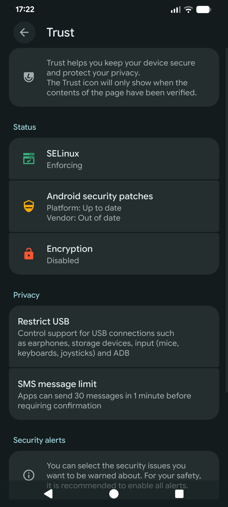
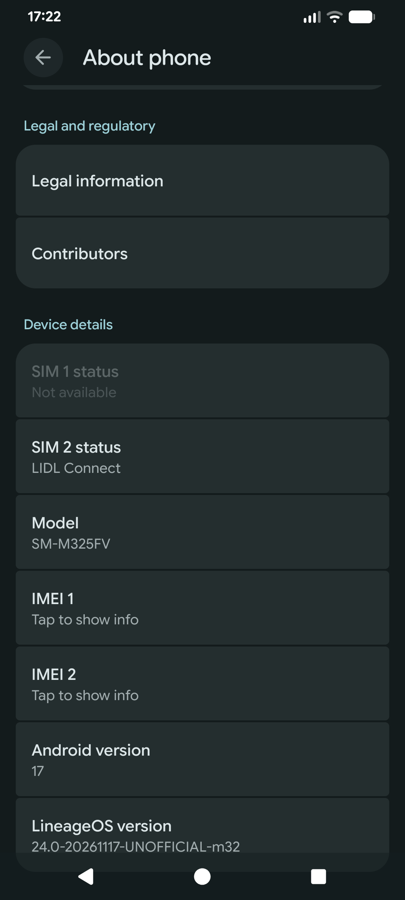

# LineageOS 24.0 UNOFFICIAL — Galaxy M32 4G (SM-M325FV)

Unofficial LineageOS 24.0 (Android 17) builds for the Samsung Galaxy M32 4G
(SM-M325FV, mt6768 / Helio G80). Vanilla build, no GApps, own signing keys.

| | |
|---|---|
| Latest build | `lineage-24.0-20261117-UNOFFICIAL-m32` |
| Android | 17 (LineageOS 24.0) |
| SELinux | enforcing |
| Downloads | [Releases](../../releases) |

## Screenshots

| Setup | Trust | About phone |
|---|---|---|
|  |  |  |

## What works (device-verified)

- Data on **both** SIM slots (dual-SIM DSDS), calls, SMS, IMS registration
- Camera (rear/front, photo), flashlight, torch tile
- 90 Hz display, Wi-Fi, Bluetooth, NFC, fingerprint, sensors
- SELinux enforcing, own release keys (`release-keys` build tag)
- TWRP stays installed: the Lineage recovery updater and both setup-wizard pages
  that could trigger it are removed from the build

## Changes in 20261117

- **SIM slot 2 data fixed.** The vendor RIL advertises `IRadioConfig` 1.1 but never
  answers `setPreferredDataModem` for the second logical modem, which left the slot
  in a retry loop and rejected the data call locally. PhoneSwitcher now falls back
  once to the legacy allow-data path and re-evaluates; the DDS switch then completes
  and the data call comes up.
- **Setup wizard cleanup.** The "Update Lineage Recovery" page and the LineageOS
  privacy/consent page are removed from the wizard flow, and both activities are
  disabled in the manifest. No telemetry collection is built.
- **Stats default.** The provider no longer forces `def_stats_collection=true`, and a
  database migration resets a leftover `stats_collection=1` on upgraded installs.
- **sehradiomanager** ships with corrected ISehRadio reply handling (no more crash on
  the FW_READY response).

## Install

1. TWRP 3.6.11 by Mujammil (XDA thread 4800621), boot into recovery
2. `multidisabler` in the TWRP terminal
3. **Format Data** (the stock `/data` is f2fs with metadata encryption)
4. Flash the zip from `/data/local/tmp` (not `/sdcard`), reboot

**Never relock the bootloader** — AVB is broken after flashing, relocking hardbricks the
device.

## Known issues

- Signal-bar stability on the secondary subscription still under observation
- Vendor blobs are pinned to the stock firmware, so the vendor security patch level is
  older than the platform one
- ~54 interface methods still carry empty argument lists versus the stock signatures
  (the stock transport libraries are used, so this is latent)

## Credits

- Device trees: [samsung-mt6768-aosp](https://github.com/samsung-mt6768-aosp)
- TWRP: Mujammil (XDA thread 4800621)

UNOFFICIAL build, no warranty of any kind.
