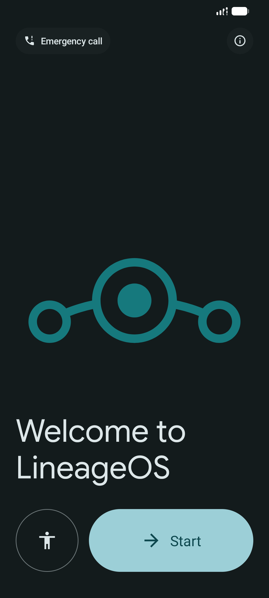

# LineageOS 24.0 UNOFFICIAL — Galaxy M32 4G (SM-M325FV)

Unofficial LineageOS 24.0 (Android 17) for the Samsung Galaxy M32 4G. Vanilla, no GApps,
own signing keys, SELinux enforcing.

Latest: `lineage-24.0-20261117-UNOFFICIAL-m32` → [Releases](../../releases)

## Screenshots

| Setup | Trust | About phone |
|---|---|---|
|  |  |  |

## Fixed since last release

- SIM slot 2 data: DDS switch now falls back to the allow-data path, both slots get data
- Setup wizard: recovery-update and LineageOS consent pages removed, activities disabled
- No telemetry: stats collection off by default, legacy value reset on upgrade

## Removed

- Lineage recovery updater — TWRP stays on the recovery partition
- lineagestats (collector, services, wizard toggle)

## Install

Use the `m32` build for SM-M325FV only — do not cross-flash with the SM-M325F build.

### 1. Unlock the bootloader

1. Settings → About phone → tap **Build number** seven times
2. Developer options → enable **OEM unlocking** and **USB debugging**
3. Power the phone **fully off**
4. Hold **Volume Down + Volume Up** and plug in the USB cable — the unlock warning appears
5. Confirm with **Volume Up** (this wipes the device)
6. After boot check: `adb shell getprop ro.boot.vbmeta.device_state` → `unlocked`

### 2. Flash TWRP + vbmeta disabler (download mode)

Both go in the same step: TWRP itself is unsigned, so stock AVB verification has to be
switched off or the recovery will not boot.

1. Power off, then hold **Power + Volume Down** → download mode
2. Windows: Odin — `recovery.img.tar` **in AP**, `vbmeta.img.tar` (the vbmeta disabler)
   **in USERDATA**, **uncheck Auto-Reboot**, start
   Linux: `systemctl stop ModemManager`, then
   `heimdall flash --recovery recovery.img --vbmeta vbmeta.img --no-reboot`
   (partition names are lowercase: `recovery`, `vbmeta`)
3. Wait for the flash, the phone stays in download mode

This is a one-time step. The ROM zip writes its own disabled vbmeta images
(`vbmeta`, `vbmeta_system`, `vbmeta_vendor`) on every flash, so later updates and clean
flashes do not need the manual step again.

### 3. Boot into TWRP

- Hold **Power + Volume Up** until the Samsung logo shows, then release
- If it boots the system instead: hold **Volume Down + Power** until the screen goes
  black, then immediately switch to **Volume Up + Power**

TWRP 3.6.11 starts. Don't let it time out into the system.

### 4. First install only: flash multidisabler

Only needed **once**, when the phone still runs Samsung stock firmware — it removes Samsung's
verity/force-encrypt flags so TWRP can format `/data` and the ROM is not blocked on boot.

- TWRP → **Install** → pick `multidisabler.zip` → swipe to confirm
- The ROM itself ships a fstab without force-encrypt, so later clean flashes and updates
  do **not** need it again

### 5. Clean flash

1. **Wipe → Format Data** → type `yes` (erases internal storage; required because stock
   `/data` is f2fs with metadata encryption)
2. Copy the zip **after** the wipe:
   ```
   adb shell mkdir -p /data/local/tmp
   adb push lineage-24.0-20261117-UNOFFICIAL-m32.zip /data/local/tmp/
   adb shell md5sum /data/local/tmp/lineage-24.0-20261117-UNOFFICIAL-m32.zip
   ```
   Compare with `md5sum <zip>` on the PC. Pushing to `/sdcard` can silently truncate —
   always push to `/data/local/tmp` and verify the hash.
3. TWRP → **Install** → pick the zip in `/data/local/tmp` → swipe to confirm
4. On `script succeeded`: delete the zip (`adb shell rm /data/local/tmp/<zip>`) and
   **Reboot → System** (no second wipe)
5. First boot takes ~5 minutes. adb is off again until you re-enable Developer options
   and USB debugging

TWRP stays on the recovery partition — this build no longer ships the Lineage recovery
updater.

**Never relock the bootloader** (hardbrick).

Credits: device trees [samsung-mt6768-aosp](https://github.com/samsung-mt6768-aosp), TWRP by Mujammil.
UNOFFICIAL build, no warranty.
